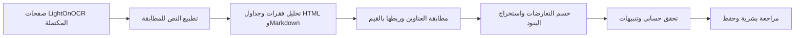

# استخراج الحقول بالقواعد

الافتراضي `EXTRACTION_METHOD=regex`. يعمل المستخرج داخل backend بعد اكتمال كل صفحات OCR، دون تحميل نموذج تحليل أو طلب شبكة أو اشتراط مفتاح. يمكن تفعيل المسار السابق صراحةً بـ`EXTRACTION_METHOD=openai` وإعادة التشغيل. لا توجد إحالة تلقائية إلى LLM.

## البايبلاين — النسخة v2

1. يقرأ العامل كل صفحة ويحفظ النص الخام؛ لا يبدأ الاستخراج حتى تكتمل الصفحات. يمكن إعادة الاستخراج من القراءة المحفوظة دون تشغيل OCR أو أي خدمة تحليل.
2. تُوحّد الأرقام العربية والفارسية والفواصل والمسافات. تُطبع الهمزات والتشكيل عند مطابقة العناوين فقط، وتبقى كتابة القيم الأصلية ومحتوى OCR محفوظين.
3. يفصل HTMLParser الفقرات عن الجداول ويجمع ` ` داخل الفقرة، فلا يتوقف اسم المورد عند أول سطر. يوسّع `rowspan` و`colspan` إلى شبكة أعمدة مع تتبع الخلايا الأصلية. Markdown له قارئ مستقل.
4. تُطابق العناوين العربية والإنجليزية مطابقة صريحة أولًا. يمكن مطابقة عنوان كامل طويل (8 أحرف دون المسافات على الأقل) بفارق حرف واحد: حذف أو إضافة أو استبدال أو تبديل حرفين متجاورين. يُشترط أن تشير المطابقة إلى حقل واحد، وتظهر في الدليل وتنبيه يحتاج إقرارًا. لا تُطبق المطابقة التقريبية على الأرقام أو أسماء الموردين أو الكلام الحر.
5. تُربط القيم بالعناوين قبلها أو بعدها عند وجود فاصل صريح، أو في السطر التالي لعُنوان مستقل دون تجاوز عنوان آخر أو فاصل صفحة. داخل الجداول تُقرأ العناوين والقيم من الخلايا الأصلية في الاتجاهين. أكثر من قيمة محتملة يبقى تعارضًا، ولا يُختار الرقم الأقرب تلقائيًا.
6. تُحدد أعمدة البنود حسب عناوينها ويُفصل صف الإجماليات عن المنتجات. دمج خلايا الإجماليات لا يلغي المنتجات. وصف منتج ممتد على صفين يحافظ على المحاذاة؛ أما دمج النص بين عمودين مختلفين للبند فيُترك هذا الصف للمراجعة مع الحفاظ على الصفوف الواضحة.
7. يُجمع المرشحون لكل حقل؛ التعارض أو القيمة غير المعروفة يترك الحقل فارغًا. التحقق الحسابي يعمل بعد الاستخراج، ويعيد التنبيهات دون إصلاح الأرقام. الحفظ والمراجعة منفصلان عن اقتراحات المستخرج.

## ما يستخرجه

- رقم الفاتورة، المورد، التاريخ، المجموع الفرعي، مبلغ الضريبة، الإجمالي والعملة.
- عناوين عربية وإنجليزية، وأرقام عربية وفارسية، وبعض صيغ الفصل العشري والآلاف.
- البنود من جداول HTML وMarkdown؛ تعيين الأعمدة بحسب عنوانها، لا موضعها الثابت. HTML يُقرأ بـHTMLParser؛ لا تُنفذ محتوياته أو تُحمّل روابطه.
- اسم المورد الصريح، أو عنوان شركة في بداية النص قبل الفاتورة. يُفضّل العنوان الأطول إذا احتوى عنوانًا مختصرًا كاملًا من نفس البداية؛ الشركات المختلفة تبقى تعارضًا. رقم INV فريد عند غياب عنوان رقم الفاتورة. مصدر هذه الاستدلالات يظهر في التشخيص.
- دليل لكل حقل: القاعدة، سطر المصدر، المرشحون، وحالة matched/missing/ambiguous/unrecognized. المطابقة لا تعني نسبة ثقة أو ضمان صحة OCR.

القيم المتعارضة لا يُختار آخرها تلقائيًا، ولا تُصحح الأرقام لتحقيق التطابق الحسابي. التاريخ `02/06/2024` يظل فارغًا لأنه يحتمل يوم/شهر أو شهر/يوم. النسبة المئوية لا تُعامل كمبلغ ضريبة. الدولار أو الريال دون سياق كافٍ لا يحددان رمز عملة وحدهما؛ توجد قاعدة ريال/ريالاً/riyal/rial مع سياق السعودية الصريح، والعملات المتعارضة تبقى فارغة.

## حدود النسخة

تحتاج مراجعة الجداول المتداخلة أو التالفة، والدمج الذي يحجب معنى عمود المنتج، والأعمدة غير المعروفة والصفوف الناقصة. تُحفظ ملاحظاتها وتستلزم إقرارًا عند الاعتماد. التواريخ المكتوبة بأسماء الشهور وصيغ الأرقام غير المدعومة تُترك فارغة. النص الذي لا يحتوي عنوانًا معروفًا أو قريبًا منه قد يفوت المستخرج؛ هو ليس نموذج فهم دلالي. لا يُصلح أخطاء OCR في القيم، ولا يعرف كل مرادفات الحقول. عنوان الشركة في بداية الصفحة قرينة يمكن أن تخطئ؛ يلزم التحقق من المورد مقابل العميل. تجميع أسماء الموردين يعتمد على الفقرة/العنوان، ولا يجمع أسطرًا منفصلة عشوائيًا.

Regex هنا لا يصنّف الأصناف ولا يصدر تقدير ثقة؛ تظل الوثيقة needs_review ويختار المستخدم التصنيف النهائي، ويمكن الاعتماد بلا تصنيف. لم نكتب قاعدة لكل واحد من أشكال الفواتير الـ160.

## المقارنة والحفظ

`POST /api/invoices/{id}/extract-regex` يستخدم صفحات OCR المكتملة ويحفظ `regex_result` منفصلًا عن `ai_proposal` والمراجعة السابقة. يُرفض الطلب إذا لم تكتمل صفحة أو كان العامل يعالج الوثيقة. الطلب المتكرر يعيد النتيجة المحفوظة. زر «نتيجة النموذج المحفوظة» يعرض نتيجة سابقة دون إرسال طلب جديد إلى مزودها.

زر «إعادة الاستخراج بـRegex» يستخدم `?refresh=true` لحفظ نتيجة الإصدار الحالي دون إعادة OCR. عند تغيّر النتيجة تُنقل المقارنة السابقة إلى `regex_history`. يبقى اقتراح المستخرج الأساسي والتصحيح النهائي ووقت المراجعة محفوظين. لكل نتيجة `revision` ثابت من النص والإصدار والقيم والدليل؛ الواجهة ترسله عند المراجعة، ويُرفض اعتماد نتيجة تغيّرت أثناء المراجعة. النتيجة الجديدة المختلفة لا تعرض المراجعة القديمة وكأنها اعتماد لها.

طلب المراجعة يقبل `source=original|regex`، وتُحفظ القيمة في `review_source`. تبقى اقتراحات الاستخراج الأصلية مستقلة عن الحقول والبنود النهائية. `ai_proposal` اسم تاريخي في عقد API لنتيجة المستخرج الأساسي، حتى إذا كان مصدرها Regex؛ يحدد `analysis.method` المصدر الحقيقي.

## التحقق — 5 أكتوبر 2026

نجح اختبار النص الحقيقي المحفوظ للفاتورة INV-1042: الحقول السبعة وثلاثة بنود. بقي الاختلاف الحسابي الموجود في المستند: مجموع البنود 17,250 مقابل مجموع فرعي 14,250، وأظهر التحقق تنبيهًا دون تغيير المبالغ.

قياس 100 عملية استخراج للنص نفسه داخل العملية على الجهاز الحالي: وسيط نحو 1.9ms وP95 نحو 2.7ms. يشمل الاستخراج فقط؛ لا يشمل OCR أو الشبكة أو الحفظ أو العرض، وليس اختبارًا لأداء آلاف فواتير مختلفة. نجاح هذه العينة لا يثبت دقة عامة على الفواتير العربية والإنجليزية.

اختبارات القواعد تغطي الالتباس والتعارض والضريبة كنسبة، والصيغ العددية والسالبة والصفر، وعدم التقاط بيانات العميل أو تاريخ الاستحقاق أو المعرف الضريبي كحقول خاطئة، والجداول وإقرار التنبيهات والحفظ وفصل المراجعة عن النتيجة السابقة. يوجد اختبار يمنع إنشاء عميل OpenAI أثناء المسار المحلي ولو كان المفتاح موجودًا.

## التحقق من v2 — 5 أكتوبر 2026

نجح 48 اختبار backend و7 اختبارات React و3 اختبارات مسار كامل ببدائل OCR/OpenAI معلنة، مع استخدام خدمة Regex الحقيقية في المقارنة وإعادة الاستخراج.

أُعيد استخراج القراءات الأربع المحلية المكتملة دون تشغيل OCR أو إرسالها لخدمة خارجية. فاتورة الرواد أصبحت تحتوي الحقول السبعة وبندين: `SAL-2024-0876`، شركة الرواد للحلول الحاسوبية، `2024-06-02`، مجموع فرعي `7900`، ضريبة `1185`، إجمالي `9085`، و`SAR`. يظهر تنبيه لأن عنوان الإجمالي يحتوي خطأ OCR عولج بمطابقة تقريبية. الملفات الثلاثة الأخرى احتفظت بحقولها السبعة وبنودها، وبقي تنبيه التعارض الحسابي في الفاتورة اليدوية. تمت مقارنة حقول OCR والاقتراحات والتصحيحات السابقة قبل/بعد الحفظ والتأكد من عدم تغييرها.

في قياس 100 استخراج متتابع لنص الرواد داخل العملية: الوسيط نحو 3.5ms وP95 نحو 5.3ms، للاستخراج فقط بما فيه الدليل ومعرّف المراجعة. أول طلب حفظ المقارنة سجل نحو 21ms للاستخراج، دون OCR أو تخزين/نقل/عرض. هذه أمثلة تطوير وفحص محدود، وليست قياس دقة على مجموعة مستقلة أو ضمانًا للإنتاج.
